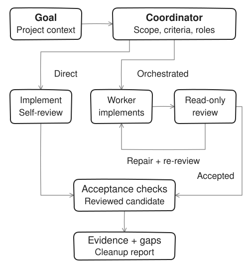

<p align="center">
  
</p>

# MAY

Workflow skills for coding agents.

MAY helps an agent turn a coding goal into a scoped plan, implementation, review, and acceptance evidence. It ships nine skills and three Bash scripts for use with Pi, Oh My Pi, Codex, and Claude Code. A small repair can stay with one agent; complex work can use a coordinator and relevant workers.

Your harness still controls models, accounts, tools, permissions, and delegation. MAY supplies written guidance and deterministic scripts, not a workflow engine or sandbox.

[Why MAY](#why-may) · [Install](#install) · [Start a task](#start-a-task) · [Workflow](#workflow) · [Skills](#skills) · [Runtime guide](skills/using-may/references/runtime.md) · [Contributing](CONTRIBUTING.md)

## Why MAY

Spawning a subagent answers who can do a task. MAY adds a shared contract for what to hand off, when a candidate is ready for review, and which evidence supports acceptance. This is useful when you want those responsibilities stated consistently instead of reconstructing them for each task.

| Responsibility | Native delegation by itself | MAY's documented convention |
|---|---|---|
| Plan and handoff | The harness provides task dispatch; the caller supplies the brief | Goal, scope, dependencies, inputs, outputs, and observable criteria |
| Team selection | Available workers and modes depend on the harness | Direct for small low-risk work; only justified roles otherwise; coordinator-only dispatch |
| Review | Separation and review policy depend on the caller | Read-only review before final QA, repairs back to the same reviewer; disclosed self-review for Direct work |
| Acceptance evidence | The caller decides what results establish completion | Exact criterion commands, current-candidate evidence, explicit failures and blocked checks |
| Temporary work | Process and artifact handling depend on the tools and caller | Marked OS-temp sessions, retained failure diagnostics, exact-session cleanup |

A native workflow can implement these same patterns. MAY packages the conventions; advisory skills do not automatically enforce them. There are no published comparative token, time, or quality benchmarks here, so this table compares responsibilities, not measured superiority.

## Install

Install MAY separately in each harness you use, then start a fresh session. These are integration targets, not a guarantee that every model, version, or workflow has been tested. See [requirements and limits](#requirements-and-limits).

### Pi

```bash
pi install git:github.com/Rakhulsr/MAY
```

### Oh My Pi

```bash
omp plugin marketplace add Rakhulsr/MAY
omp plugin install may@may
```

### Codex

```bash
codex plugin marketplace add Rakhulsr/MAY
codex plugin add may@may
```

### Claude Code

Run inside Claude Code:

```text
/plugin marketplace add Rakhulsr/MAY
/plugin install may@may
```

## Start a task

Open your project in a fresh harness session and name MAY explicitly:

```text
Use MAY to fix login validation. Preserve my changes and prove the fix
with a regression test. First read the installed using-may skill and
its orchestration contract, then state the scope and acceptance checks.
```

Confirm the agent actually reads the installed `using-may/SKILL.md` and its referenced orchestration and harness mapping before work starts. Use the harness's visible file/tool activity where available; a reply saying “MAY is active” alone is not evidence. If the skill cannot be found, resolve installation/discovery before continuing.

For planning only:

```text
Use MAY to plan password reset for this app. Inspect the existing auth
and email code, recommend an approach, and define acceptance checks.
Keep the plan in chat; do not change files yet.
```

The agent should inspect code and Git status, reuse settled decisions, and ask only material unanswered questions. You can answer “recommend for me” to delegate a choice with its rationale and tradeoffs. Planning does not require an external brainstorming skill; planning-only work ends with human plan review, not application tests presented as proof of prose.

See a [real verification-step example](skills/using-may/references/examples.md), with its exact observed output and limits.

## Workflow



[Editable diagram source](assets/diagrams/workflow.svg)

Arrows show the work sequence, not permission to spawn workers: only the coordinator dispatches. One PM or Tech Lead coordinator applies both planning perspectives; roles are not a requirement to start every agent. Orchestrated work keeps one writer at a time and uses separate review and QA tasks when delegation is available. Direct work uses non-independent self-review and must say so. Without delegation, tasks run sequentially with the same disclosure.

Every source and test repair returns to review before final QA. After two unsuccessful repair rounds, the agent asks you how to proceed. Changes to source, tests, builds, or fixtures invalidate affected evidence. The [orchestration contract](skills/using-may/references/orchestration.md) defines the full planning and acceptance rules; the [runtime guide](skills/using-may/references/runtime.md#what-runs-where) shows the execution boundary.

## Skills

Roles are responsibility profiles, not mandatory processes. They give advice grounded in the project and approved scope; Security and DevOps do not automatically add controls or infrastructure. UX consultation can use text.

| Skill | Use it for |
|---|---|
| [using-may](skills/using-may/SKILL.md) | Workflow selection and harness-specific tool mappings |
| [may-pm](skills/may-pm/SKILL.md) | Requirements, scope, priorities, and acceptance criteria |
| [may-tech-lead](skills/may-tech-lead/SKILL.md) | Architecture, tradeoffs, task boundaries, and dependencies |
| [may-ui-ux](skills/may-ui-ux/SKILL.md) | User flows, interaction design, accessibility, and visual review |
| [may-frontend](skills/may-frontend/SKILL.md) | Components, client behavior, API integration, and browser regressions |
| [may-backend](skills/may-backend/SKILL.md) | APIs, domain logic, data integrity, integrations, and tests |
| [may-qa](skills/may-qa/SKILL.md) | Acceptance checks, regression coverage, and current-artifact evidence |
| [may-security](skills/may-security/SKILL.md) | Threat modeling, auth, secrets, trust boundaries, and review |
| [may-devops](skills/may-devops/SKILL.md) | Development environments, builds, CI, and deployment risk |

## Requirements and limits

- Pi, Oh My Pi, Codex, and Claude Code have native integration metadata and tool mappings. Available tools, permissions, and model behavior depend on your harness and configuration.
- Runtime scripts require Bash, Git, and core/system utilities. Use Git Bash on Windows. Node is needed for MAY's repository tests, not workflow state.
- Browser verification needs a trusted browser connection or the project's already-installed Playwright. MAY does not install browser tooling automatically. Missing capability is blocked, not a pass.
- MAY has no database, background service, persistent workflow state, or cross-session resume. Plans and reports stay in chat unless you request files. New sessions start from code and Git status.
- Skills cannot enforce model compliance or provide isolation. See the [trust and security policy](SECURITY.md) before authorizing commands or handling sensitive data.

For agent-managed and manual checks, exit codes, failure-artifact inspection, and interrupted-session cleanup, read the [runtime guide](skills/using-may/references/runtime.md). For repository setup, checks, and local plugin development, read [CONTRIBUTING.md](CONTRIBUTING.md). Changes are recorded in [CHANGELOG.md](CHANGELOG.md).

## License

[MIT](LICENSE)
