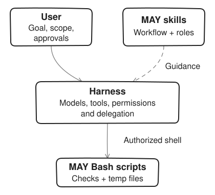

# Runtime guide

Normally, ask for the outcome: “Use MAY to build login and test it in the browser.” The agent resolves the installed `may` skill and runs the relevant scripts from your target project. Scripts ship inside the skill, not your project. The [orchestration contract](orchestration.md) remains the canonical planning, review, and acceptance policy.

## What runs where



[Editable diagram source](../../../assets/diagrams/runtime-boundary.svg)

The harness runs the agent and controls access. MAY skills guide its decisions; bundled scripts perform deterministic shell operations with the permissions already granted. They do not host agents or enforce the written review gates. Plans and reports stay in chat unless requested as files. Temporary logs and process records are not persistent workflow state.

## Scripts and requirements

| Script | Purpose |
|---|---|
| [may-session.sh](../scripts/may-session.sh) | Create marked OS-temp folders, record processes, and stop or recover a session |
| [may-verify.sh](../scripts/may-verify.sh) | Run criterion commands and print a revision-aware `MAY VERIFY` table |
| [may-e2e.sh](../scripts/may-e2e.sh) | Run the project's already-installed Playwright tests, optionally starting a local server |

Session and verification scripts require Bash, Git, and core/system utilities. Use Git Bash on Windows and quote paths. Only the initial invocation needs that explicit Bash: the scripts run their helpers and criterion commands with the same interpreter that launched them, regardless of which `bash` comes first on `PATH`. The optional E2E runner also needs npx and installed Playwright, plus curl when waiting for a server. Node is required for MAY's repository tests, not workflow state. MAY does not provision a browser connection or install dependencies automatically.

## Acceptance checks

The agent runs the plan's actual criterion commands after current review acceptance. For optional manual use, resolve the installed skill's absolute path through your harness and set `MAY_SKILL_DIR` in that shell. This variable is a convenience, not required global configuration. Replace `AC1` and the command with the criterion being checked:

```bash
bash "$MAY_SKILL_DIR/scripts/may-verify.sh" --check "AC1=npm test" --timeout 600
```

Repeat `--check "ID=command"` for more criteria. Identical commands execute once and identify all covered criteria. The agent displays the complete `MAY VERIFY` table. To inspect output for a `PASS`, add `--show-output`: it prints the last 40 lines, not a complete log. The command string and output tails for non-PASS results are displayed even without this option; commands and output must be safe to disclose and must not contain secrets. Temporary logs are removed on successful cleanup; cleanup failure can retain them. See an [observed verifier example](examples.md#observed-verification-step).

| Status | Meaning |
|---|---|
| `PASS` | Command succeeded in Git without detected tree drift or common empty-test output |
| `FAIL` | Command or cleanup failed |
| `NO_TESTS` | Output matched a common zero-test pattern |
| `TRIVIAL` | Command matched an always-successful or non-evidence pattern |
| `CHANGED` | Git revision or working-tree fingerprint changed during the run |
| `TIMEOUT` | Command exceeded its timeout |
| `PASS?` | Command succeeded outside Git; result is inconclusive |

Only `PASS` counts toward acceptance. Outside Git, `PASS?` exits 1; an unborn Git repository is labeled `unborn`. The verifier exits 0 only when all criteria pass and cleanup succeeds, 1 for a non-passing result, or 2 for invalid arguments. Shell interruption can produce a signal-related exit. Failed checks, common zero-test output, trivial commands, drift, and timeouts do not become passes.

Go package summaries are combined only within the same check command: `[no test files]` or `[no tests to run]` means `NO_TESTS` only when no other package reports a successful timed or cached result. Other recognized empty-suite markers still reject the check. Cached results are not proof of fresh test execution.

A passing command does not establish assertion quality, full requirement coverage, or browser build identity. Review and appropriate browser evidence are still necessary. Source, test, build, or fixture changes invalidate affected evidence: renew review acceptance, then rerun affected checks. Planning-only work uses human plan review, not invented executable evidence.

## Browser checks

| Available capability | Route |
|---|---|
| Trusted native browser connection | Exercise the agreed flow and collect current browser evidence |
| No trusted connection; Playwright already installed in the project | Write or select an appropriate browser regression, then use the optional runner |
| Neither route available | Report browser verification as blocked and ask permission before installing anything |

Screenshots alone do not verify implemented browser behavior. The runner executes tests; it does not create them. Non-loopback URLs require an explicit user request and `--remote-ok`. Production is never an allowed target. This is a workflow restriction, not a claim that the script can recognize every production environment; check the actual target before running it. Test configuration and commands must also stay within approved scope.

### Runner exits and evidence

| Exit | Meaning and next action |
|---|---|
| `0` | Pass. Stop the exact session and check cleanup succeeded |
| `1` | Test, readiness, or process-cleanup failure. Stop with `--keep`, inspect diagnostics, then stop without it |
| `2` | Invalid usage or rejected target. Retain and inspect any diagnostics with the same `--keep` lifecycle |
| `3` | Playwright unavailable. Clean the session, report blocked rather than failed regression, and ask installation permission |

Successful test artifacts are removed. Failure artifacts must remain available until inspection, even when that needs another tool call. Preserve the runner result in the report; a cleanup error is an additional failure with the remaining path disclosed.

### Optional manual browser run

Resolve the installed skill's absolute directory and set `MAY_SKILL_DIR` in this shell. Replace the spec, start command, and URL with actual project values. Run from the target project. Record the printed absolute session path in task/chat context before proceeding: shell variables may not survive between calls.

```bash
(
  session="$(bash "$MAY_SKILL_DIR/scripts/may-session.sh" start)" || exit 1
  printf 'Session: %s\n' "$session"
  cleanup() {
    result=$?
    trap - EXIT
    if [ "$result" -eq 0 ] || [ "$result" -eq 3 ]; then
      bash "$MAY_SKILL_DIR/scripts/may-session.sh" stop "$session" || exit 1
    else
      bash "$MAY_SKILL_DIR/scripts/may-session.sh" stop "$session" --keep || exit 1
      printf 'Inspect retained diagnostics, then stop this session: %s\n' "$session"
    fi
    exit "$result"
  }
  trap cleanup EXIT
  if bash "$MAY_SKILL_DIR/scripts/may-e2e.sh" --session "$session" --spec tests/login.spec.ts --start "npm run dev" --url http://localhost:3000; then
    exit 0
  else
    exit "$?"
  fi
)
```

On failure or invalid usage, this EXIT trap stops recorded processes with `--keep`, leaving diagnostics for the next tool call. Pass and unavailable results clean the session. It preserves the original runner exit unless cleanup fails, which returns failure. Do not replace it with an unconditional deleting trap before evidence inspection.

After inspecting retained logs and artifacts, resolve the installed skill path again if necessary, and substitute the recorded absolute session path:

```bash
bash "$MAY_SKILL_DIR/scripts/may-session.sh" stop "/absolute/session/path/printed/above"
```

A cleanup error needs recovery of that exact path, not a claim that cleanup succeeded. The manual example is a command template; it is not evidence that your project's test or server command exists or passes.

## Cleanup and interruption

Create temporary work only with `may-session.sh start` and record its absolute path. Under Windows Git Bash the scripts print session and artifact paths in `C:/…` form, which both Bash and the harness's native file tools can open; `stop` accepts that form or the MSYS form. Track background process identities through `may-session.sh track <dir> <pid>` where needed. `stop <dir> --keep` stops recorded processes but retains files for inspection; `stop <dir>` removes the known marked folder after inspection. Never collect or delete unrelated `may-*` folders or processes.

Attempt exact-session cleanup on failure or cancellation. An EXIT trap cannot guarantee recovery after a forced kill. A later call or fresh session can stop the recorded path without relying on lost shell variables. Resolve `MAY_SKILL_DIR` again and use the same OS-temp root if environment overrides were used to create the session. Report only observed cleanup and disclose any remaining owned path or process.

`sweep` is separate stale-folder recovery for marked sessions at least 24 hours old with no live recorded process/group; `start` also runs that default sweep. It is not proof that an interrupted run cleaned up. There is no MAY workflow-state folder in the project or home directory, and a fresh session does not resume stored workflow state.
